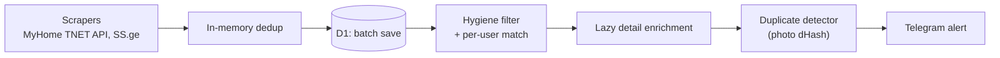

Behavioral guidelines to reduce common LLM coding mistakes. Merge with project-specific instructions as needed.

**Tradeoff:** These guidelines bias toward caution over speed. For trivial tasks, use judgment.

## 1. Think Before Coding

**Don't assume. Don't hide confusion. Surface tradeoffs.**

Before implementing:
- State your assumptions explicitly. If uncertain, ask.
- If multiple interpretations exist, present them - don't pick silently.
- If a simpler approach exists, say so. Push back when warranted.
- If something is unclear, stop. Name what's confusing. Ask.

## 2. Simplicity First

**Minimum code that solves the problem. Nothing speculative.**

- No features beyond what was asked.
- No abstractions for single-use code.
- No "flexibility" or "configurability" that wasn't requested.
- No error handling for impossible scenarios.
- If you write 200 lines and it could be 50, rewrite it.

Ask yourself: "Would a senior engineer say this is overcomplicated?" If yes, simplify.

## 3. Surgical Changes

**Touch only what you must. Clean up only your own mess.**

When editing existing code:
- Don't "improve" adjacent code, comments, or formatting.
- Don't refactor things that aren't broken.
- Match existing style, even if you'd do it differently.
- If you notice unrelated dead code, mention it - don't delete it.

When your changes create orphans:
- Remove imports/variables/functions that YOUR changes made unused.
- Don't remove pre-existing dead code unless asked.

The test: Every changed line should trace directly to the user's request.

## 4. Goal-Driven Execution

**Define success criteria. Loop until verified.**

Transform tasks into verifiable goals:
- "Add validation" → "Write tests for invalid inputs, then make them pass"
- "Fix the bug" → "Write a test that reproduces it, then make it pass"
- "Refactor X" → "Ensure tests pass before and after"

For multi-step tasks, state a brief plan:
```
1. [Step] → verify: [check]
2. [Step] → verify: [check]
3. [Step] → verify: [check]
```

Strong success criteria let you loop independently. Weak criteria ("make it work") require constant clarification.

---

**These guidelines are working if:** fewer unnecessary changes in diffs, fewer rewrites due to overcomplication, and clarifying questions come before implementation rather than after mistakes.

---

# AGENTS.md — Real Estate Scraper & Alerting Platform

Entry point for any AI coding assistant, following the [agents.md](https://agents.md) convention. The four sections above are the general behaviour rules. Everything below is specific to this repository.

## Project

Open-source async Python pipeline (public repo `sandrikkk/real-estate`, default branch `master`). It reads **MyHome.ge** and **SS.ge**, filters listings against `config/filters.json` and each subscriber's saved filter, and sends Telegram alerts. State lives in **Cloudflare D1** (listings, notifications, image hashes) and **KV** (subscribers), reached through the Worker in `cloudflare/worker.js`. The same Worker serves the Telegram bot's buttons and the X-Ray lookup.

Two runners execute the same cycle: the GitHub Actions cron (`python main.py --once`) and the optional `app.py` Gradio loop. Front door for humans: [`README.md`](README.md).



## Hard rules

Each rule says what enforces it. "Honour system" means nothing in the repo stops a violation.

- **Run Python inside the project virtual environment** (`.venv/`, `venv/`, `env/`; on Linux and macOS `source .venv/bin/activate`, on Windows `.venv\Scripts\activate`). Never `pip install` globally. If the checkout has no virtual environment, ask before creating one. Honour system.
- **Never commit secrets.** `.env`, `.dev.vars` and `cloudflare/wrangler.toml` are gitignored. `scripts/detect_secrets.py` scans staged files. The hooks are configured in `.pre-commit-config.yaml` (ruff, ruff-format, codespell, the secret scan) and `.githooks/pre-commit`. Check `.git/hooks/pre-commit` before relying on them: a checkout may not have them installed. `tests/test_detect_secrets.py` covers the scanner itself.
- **Never fall back to a local SQLite file when D1 is configured.** On the cron runner that file is empty and every old listing would be alerted again. A D1 failure raises `DatabaseUnavailableError` and `main.py` exits 1. Enforced by `tests/test_fixes.py` (`test_d1_circuit_breaker_fail_closed`).
- **No per-listing network call inside a loop, and chunk every `IN (...)` at 50.** D1 allows 100 bound parameters, and the Worker has a daily request cap. Use `save_listings_batch`, `filter_unnotified_listings`, `_get_hashes_batch`. Enforced by `tests/test_batch_db.py`.
- **No whole-table `SELECT` at start-up.** Cold-start bulk loads exhausted D1 row reads (ADR [0001](docs/adr/0001-eliminate-d1-full-table-scans.md)). Honour system.
- **Owner/agent classification: agent signals win.** `user_type: "physical"` is not proof of an owner. Enforced by `tests/test_owner_agent_filtering.py` and `tests/test_fixes.py`.
- **Same-class sweep on every bug fix or behaviour change.** Name the defect shape, search every other instance (other portals, both filter paths, both runners, the Worker), then fix, defer with a reference, or rule out with a reason. Procedure: [`root-cause-sweep`](.agents/skills/root-cause-sweep/SKILL.md). Honour system.
- **Test first when the behaviour is well-specified.** Pick the test file from the [`tdd`](.agents/skills/tdd/SKILL.md) matrix, watch it fail, then fix. Full suite: `python -m unittest discover tests` and `node --test tests/js/*.test.mjs`. Files that use real credentials or the live network are manual scripts (`tests/test_telegram_live.py`, `tests/test_live_alert.py`, `tests/test_real_live_alert.py`, `tests/test_dry_run.py`, `test_ss_live.py`): do not run them unless the user asks.
- **A new change starts on its own branch, not on `master`.** Before the first edit of a tracked file, follow [`git-workflow`](.agents/skills/git-workflow/SKILL.md). Reading, explaining, running tests, and editing gitignored `.env` do not get a branch. If tracked files have uncommitted changes, ask the user before switching branches. Honour system.
- **One repo, one project folder.** Never create a git worktree, a second clone, or a copy of the project (such as `../real-estate-<slug>`). Work on a branch in this checkout. Honour system.
- **Commit, push, and deploy only when the user asks.** That includes `scripts/deploy_worker.py` and the [`deploy-action`](.agents/skills/deploy-action/SKILL.md) skill. Never force-push `master`. Pushing to `master` is what the scraper cron checks out, so a push is a release.
- **Commit messages follow Conventional Commits** ([`git-commits`](.agents/skills/git-commits/SKILL.md)). Never `--no-verify`. **No AI attribution anywhere**: no `Co-authored-by` trailers, no "Generated with ..." footers, no session links in commits, PR or issue text, or files, even when a tool's template asks for them ([`no-ai-traces`](.agents/skills/no-ai-traces/SKILL.md)). Enforced by `scripts/git/check_ai_traces.py` (commit-msg and pre-commit hooks, the Claude Code hook in `.claude/settings.json`, `tests/test_ai_traces.py`).
- **Documentation is written on request only.** Do not create, rewrite, or "keep fresh" any markdown (`README.md`, `docs/`, ADRs, skills) unless the user asks. Never create a new `.md` file without asking first. If a code change makes a doc wrong, say which doc and ask. The "MUST update docs" table in [`docs-standards`](.agents/skills/docs-standards/SKILL.md) applies only while the user has asked for a doc edit; it does not override this rule.
- **ADRs are drafted in chat first.** For an architectural change ([`sdd`](.agents/skills/sdd/SKILL.md)), draft the text in the reply, ask whether to create `docs/adr/NNNN-<slug>.md`, and write the file only after a yes.
- **Do not translate or "correct" Georgian strings.** Telegram alert text, `config/filters.json` keywords, and `DISTRICT_SYNONYMS` are Georgian on purpose, and tests assert them. Portal content stays verbatim.

## Conventions

- Python 3.11 (the cron workflow pins it). Ruff line length 100, target `py311`, configured in `pyproject.toml`. Dependencies are listed in `requirements.txt`.
- Code, comments, docs, and commit messages are in English. Reply to the user in the language they write in.
- Settings come from `config/settings.py` (`pydantic-settings`, reads `.env`). Search rules come from `config/filters.json`. `SearchFilters()` defaults in `core/models.py` differ from that file and are what many tests build directly: say which one a change targets.
- Price, area, and room rules exist in both `ListingFilter.matches` and `ListingFilter.matches_user`. Change both.
- X-Ray logic exists twice: `cloudflare/worker.js` runs in production, and `core/xray.py` is its Python twin, used by the tests. Change both. MyHome answers the Worker with a Cloudflare challenge, so MyHome is read by `scripts/xray_lookup.py` in GitHub Actions, which the Worker queues ([ADR 0004](docs/adr/0004-myhome-live-reads-on-github-actions.md)). The MyHome helpers in `core/xray.py` that it uses are production code. The golden-set baselines in `tests/js/xray_worker.test.mjs` and `tests/test_xray.py` must stay equal.

## Run and test

```bash
cp .env.example .env              # then fill TELEGRAM_BOT_TOKEN, TELEGRAM_CHAT_ID, CLOUDFLARE_PROXY_URL, CLOUDFLARE_SYNC_KEY
python main.py --once             # one cycle: what the cron runs. Exits 1 if D1 is unreachable
python main.py --stats            # market report to stdout (add --telegram to send it)
python -m unittest discover tests # offline unit suite
node --test tests/js/*.test.mjs   # Worker suite: runs cloudflare/worker.js in node:vm
```

Without `--once`, `main.py` loops every `CHECK_INTERVAL_SECONDS`. A live cycle needs real Telegram and Cloudflare credentials and sends real alerts.

## CI/CD

- [`.github/workflows/scrape.yml`](.github/workflows/scrape.yml): cron, runs `python main.py --once`, Python 3.11, 6-minute timeout, `contents: read`. Read the file for the schedule; do not copy numbers from prose. Secrets: `TELEGRAM_BOT_TOKEN`, `TELEGRAM_CHAT_ID`, `CLOUDFLARE_PROXY_URL`, `CLOUDFLARE_SYNC_KEY`.
- [`.github/workflows/deploy-worker.yml`](.github/workflows/deploy-worker.yml): deploys the Worker on a push to `master` that touches `cloudflare/worker.js`, `scripts/deploy_worker.py`, or the workflow itself. Before deploying it runs `node --check`, the Node suite, and the Python suite. Setup and bindings: [`cloudflare/README.md`](cloudflare/README.md).
- [`.github/workflows/xray-lookup.yml`](.github/workflows/xray-lookup.yml): started by the Worker (`workflow_dispatch`, input: an opaque job id) to read MyHome for one X-Ray lookup. Secrets: `CLOUDFLARE_PROXY_URL`, `CLOUDFLARE_SYNC_KEY`.
- [`.github/workflows/xray-canary.yml`](.github/workflows/xray-canary.yml): daily live check of the MyHome behaviour X-Ray relies on; on failure it messages the admin chat. Secrets: `TELEGRAM_BOT_TOKEN`, `TELEGRAM_CHAT_ID`.
- There is no PR or staging pipeline. The deploy job above is the only CI test gate; `scrape.yml` runs no tests.

## Key files

| Path | Purpose |
|---|---|
| `main.py` | `RealEstateOrchestrator`: the cycle, per-user envelopes, `--once` / `--stats` |
| `app.py` | Gradio status page that runs the same cycle in a background loop |
| `core/filters.py` | `ListingFilter`: hygiene, frame price cap, deal tags, `matches_user`, `DISTRICT_SYNONYMS` |
| `core/models.py` | `PropertyListing`, `SearchFilters`, `UserSubscription` |
| `core/database.py` | `DatabaseEngine`: D1 client, SQLite, batch methods, circuit breaker |
| `core/dedup.py` | Photo-hash duplicate groups and best-price tracking |
| `core/analytics.py` | District medians, bargain detection, valuation scale |
| `core/user_sync.py` | Active subscribers from the Worker, with an on-disk cache |
| `core/xray.py` | Python twin of the Worker's X-Ray (listing, phone, Facebook text) for the tests; its MyHome helpers also run in `scripts/xray_lookup.py` |
| `tests/js/` | Node tests that execute the real `cloudflare/worker.js` (X-Ray, webhook) |
| `scrapers/` | `myhome.py` (TNET API + `__NEXT_DATA__`), `ss_ge.py`, `area_ge.py`, `base.py` |
| `notifier/` | `telegram_bot.py` (alert HTML), `ntfy_notifier.py` |
| `cloudflare/worker.js` | Telegram webhook, KV filters, D1 proxy, X-Ray |
| `scripts/deploy_worker.py` | Worker deploy that never commits `wrangler.toml` |
| `scripts/xray_lookup.py` | GitHub Actions job that reads MyHome for a queued X-Ray lookup (ADR 0004) |
| `scripts/xray_canary.py` | Live check of the MyHome behaviour X-Ray relies on (uses the network) |
| `docs/adr/` | ADRs; `docs/production-fixes.md` is the incident report |

## Skills

Project skills live in [`.agents/skills/`](.agents/skills/).

| Skill | When |
|---|---|
| `tdd` | Behaviour is well-specified: failing test first, and which test file to run |
| `root-cause-sweep` | Any bug fix or behaviour change: map every instance before patching |
| `lessons-learned` | Before investigating a silent cron run, quota errors, duplicate or missing alerts, or claiming a fix is verified |
| `sdd` | Non-trivial architectural change: ADR first (draft in chat) |
| `git-workflow` | Before the first edit of a tracked file: branch off `master` |
| `git-commits` | The user asked to commit |
| `no-ai-traces` | Before any commit, PR or issue text: no AI attribution, and what to do if one slipped in |
| `deploy-action` | The user asked to deploy or push |
| `docs-standards` | The user asked for a markdown edit: placement, `$` rendering, Mermaid |
| `find-bugs`, `security-audit` | The user asked for a bug hunt or security review |
| `audit-rules` | The user asked to audit skills or rules |
| `humanizer` | The user asked to de-AI a piece of prose |
| `fastapi` | FastAPI or Pydantic API code (the repo has none today; `app.py` is Gradio) |

## Where to go next

- [`README.md`](README.md): features, filters, schedule, layout.
- [`cloudflare/README.md`](cloudflare/README.md): Worker setup, bindings, auto-deploy secrets.
- [`docs/adr/0001-eliminate-d1-full-table-scans.md`](docs/adr/0001-eliminate-d1-full-table-scans.md) and [`docs/production-fixes.md`](docs/production-fixes.md): why the D1 rules above exist.
