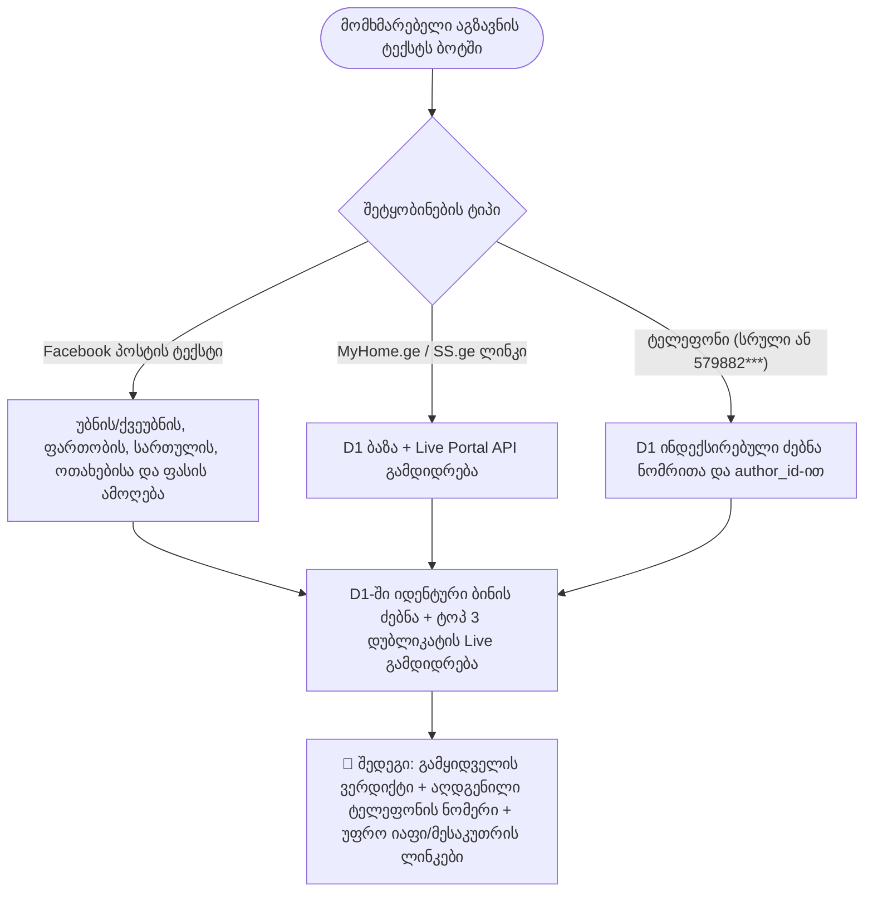

# 🚀 Cloudflare Worker 24/7 Telegram Control Panel Setup

ეს დოკუმენტი აღწერს, თუ როგორ უნდა დააყენოთ Cloudflare Worker-ი, რათა თქვენს Telegram ბოტს ჰქონდეს 24/7 სამართავი პანელი (ღილაკები) და მომხმარებლებმა თავად შეცვალონ თავიანთი ფილტრები.

---

## 1. Cloudflare Dashboard-ში KV Namespace-ის შექმნა

1. შედით [Cloudflare Dashboard](https://dash.cloudflare.com/)-ში.
2. მარცხენა მენიუში აირჩიეთ: **Workers & Pages** -> **KV**.
3. დააჭირეთ ლურჯ ღილაკს **Create a namespace**.
4. ჩაწერეთ სახელი: `USERS_KV` და დააჭირეთ **Add**.

---

## 2. Worker-ის კოდის განახლება

1. გახსენით თქვენი Worker-ი (ან შექმენით ახალი): **Workers & Pages** -> თქვენი Worker -> **Edit code**.
2. წაშალეთ იქ არსებული კოდი და ჩასვით ფაილ [cloudflare/worker.js](worker.js)-ის სრული შინაარსი.
3. დააჭირეთ **Save and Deploy**.

---

## 3. ცვლადების და KV-ს დაკავშირება (Bindings & Variables)

Worker-ის გვერდზე გადადით **Settings** -> **Variables and Secrets**:

### ა) KV Namespace Binding
1. ჩამოდით ქვემოთ **KV Namespace Bindings** განყოფილებამდე და დააჭირეთ **Add binding**.
2. **Variable name:** `USERS_KV` *(ზუსტად ასე დიდი ასოებით)*
3. **KV namespace:** აირჩიეთ პირველ ნაბიჯში შექმნილი `USERS_KV`.
4. დააჭირეთ **Save and Deploy**.

### ბ) Environment Variables & Secrets
დაამატეთ ორი ცვლადი:
1. `TELEGRAM_BOT_TOKEN` (Secret) -> თქვენი Telegram Bot-ის ტოკენი (მაგ. `7123456789:AAH...`)
2. `SYNC_KEY` (Secret ან Variable) -> თქვენს მიერ მოფიქრებული საიდუმლო პაროლი Python სკრიპტისთვის (მაგ. `my_super_secret_key_123`)

---

## 4. Telegram Webhook-ის გააქტიურება (1-Click)

ბრაუზერში გახსენით შემდეგი ბმული (ჩაანაცვლეთ `<YOUR_BOT_TOKEN>` და `<YOUR_WORKER_URL>`):

```text
https://api.telegram.org/bot<YOUR_BOT_TOKEN>/setWebhook?url=https://<YOUR_WORKER_URL>.workers.dev/telegram-webhook
```

თუ ბრაუზერმა დაგიბრუნათ `{"ok": true, "result": true, "description": "Webhook was set"}`, ბოტი მზადაა!

---

## 5. შემოწმება

1. შედით თქვენს Telegram ბოტში და მიწერეთ: `/start` ან `/filter`.
2. ბოტი წამიერად გამოგიგზავნით ინტერაქტიულ ღილაკებს:
   - `[ 🏷️ ტიპის შეცვლა (იყიდება / ქირავდება / ორივე) ]`
   - `[ 👤 განმცხადებელი: ყველა / მხოლოდ მესაკუთრე / მხოლოდ სააგენტო ]`
   - `[ 💰 ფასის შეცვლა ]`
   - `[ 📐 ფართობის შეცვლა ]`
   - `[ 📍 უბნების არჩევა ]`
   - `[ 🔔 დაპაუზება / ჩართვა ]`
3. შეცვალეთ ნებისმიერი პარამეტრი — ცვლილება მომენტალურად ჩაიწერება Cloudflare KV-ში.
4. ასევე შეგიძლიათ გამოიყენოთ პირდაპირი ბრძანება `/owner` ან `/მესაკუთრე` (მაგ: `/owner owner`, `/owner agent`, `/owner all`).

---

## 6. 🔎 On-Demand X-Ray („რენტგენი“) — გამოყენების სახელმძღვანელო და Use Case-ები

Telegram ბოტში ნებისმიერ დროს (ბრძანების გარეშე) შეგიძლიათ ჩააგდოთ **Facebook ჯგუფის პოსტის ტექსტი**, **MyHome.ge / SS.ge-ს ლინკი** ან **ტელეფონის ნომერი**. Worker-ი D1 ბაზასა და პორტალების Live API-ს აერთიანებს, რათა იპოვოს რეალური მესაკუთრე, დაფარული ტელეფონის ნომერი და იგივე ბინის უფრო იაფი ვერსია.



### Use Case 1: Facebook ჯგუფის პოსტით ნომრისა და იაფი/მესაკუთრის ვერსიის პოვნა

Facebook-ის უძრავი ქონების ჯგუფებში მაკლერები და მესაკუთრეები ხშირად ტელეფონის ნომერს არ წერენ („მომწერეთ პირადში“), თუმცა იგივე ბინა პარალელურად დევს MyHome.ge-ზე ან SS.ge-ზე.

- **სტანდარტული შემთხვევა (როცა სართული ცნობილია):**
  პირდაპირ დააკოპირეთ პოსტის ტექსტი ბოტში, მაგალითად:
  `იყიდება ბინა ნუცუბიძეზე! 60 კვ.მ, მე-7 სართული, 3 ოთახი, ფასი 83000$. მომწერეთ პირადში`
  - **რას აკეთებს X-Ray:** ქვეუბანს („ნუცუბიძე“) ავტომატურად აკავშირებს მშობელ უბანთან („საბურთალო“ / „ვაკე-საბურთალო“), ფილტრავს გაყიდვის განცხადებებს ზუსტად მე-7 სართულზე (`60 ± 1.5 მ²`), პორტალიდან ლაივში მოაქვს ნაპოვნი ბინის ტელეფონის ნომერი და გიჩვენებთ როგორც სათაურში (`📞 ტელეფონი: +995 599 ...`), ისე თითოეული დუბლიკატის გასწვრივ (მაგ. MyHome.ge — `$78,000`, `-$5,000` უფრო იაფად | `მესაკუთრე ✅` | `📞 +995 599 ...`).
- **როცა FB პოსტში სართული არ წერია:**
  სხვა სართულის ბინებთან ცრუ დამთხვევის გამოსარიცხად, X-Ray ითხოვს, რომ ტექსტში მითითებული იყოს **უბანი, ფართობი, ოთახების რაოდენობა და ფასი**. ბოტი მოძებნის მხოლოდ იმ ბინებს, რომლებსაც იგივე ოთახების რაოდენობა აქვთ და ფასი FB პოსტის ფასთან `±10%`-ის ფარგლებშია.

### Use Case 2: MyHome.ge ან SS.ge-ს ლინკის შემოწმება („ფარული მაკლერისა“ და ფასდაკლების დეტექტორი)

ჩააგდეთ ნებისმიერი განცხადების ბმული პირდაპირ ბოტში:
`https://www.myhome.ge/ka/pr/22051234/...` ან `https://home.ss.ge/ka/udzravi-qoneba/...-31948512`

- **ვინ დგას განცხადების უკან:** ამოწმებს პორტალის მეტამონაცემებს (`is_owner`, `userEntityType`, `statements_count`) და D1 ბაზაში ამავე ნომერზე/ავტორზე არსებულ სხვა ბინებს (`✅ რეალური მესაკუთრე`, `🕵️‍♂️ სავარაუდო ფარული მაკლერი / სააგენტო` ან `⚠️ სტატუსი დაუზუსტებელია`).
- **ფასის ისტორია და საბაზრო შეფასება:** ადარებს მიმდინარე ფასს პირველად დაფიქსირებულ ფასთან (`initial_price_usd`) და უბნის საშუალო `$/მ²`-სთან.
- **იგივე ბინა სხვაგან:** პოულობს იგივე ბინის სხვა განცხადებებს (`group_id`-ით ან `უბანი + ფართობი ±1.5 მ² + სართული + ოთახები`), გიჩვენებთ ფასთა სხვაობას (მაგ. `-$6,000` უფრო იაფად) და თითოეული ალტერნატივის ტელეფონის ნომერს.

### Use Case 3: ტელეფონის ნომრის რენტგენი (სრული ან დაფარული ნომერი)

ჩააგდეთ ნომერი ნებისმიერი ფორმატით: `599 11 22 33`, `+995-599-11-22-33` ან ბოტის შეტყობინებიდან დაკოპირებული დაფარული ნომერი `579882***`.

- **რას აბრუნებს:** ამ ნომერსა და მის `author_id`-ზე მიბმულ ყველა განცხადებას ბაზაში, ითვლის რამდენ სხვადასხვა ბინას ყიდის ავტორი, და თუ მაკლერის მიერ დადებულ ბინას ბაზაში რეალური მესაკუთრის დუბლიკატიც მოეძებნა, `🎯 იგივე ბინა სხვაგან:` ბლოკში პირდაპირ გიჩვენებთ მესაკუთრის ლინკსა და ტელეფონის ნომერს.
- **myhome-ზე ძებნა (ორი შეტყობინება):** ბაზის პასუხი მაშინვე მოდის, ხაზით `🔄 myhome-ზე ვეძებ`. myhome Worker-ს Cloudflare-ის შემოწმებით ბლოკავს, ამიტომ ძებნას GitHub Actions აკეთებს ([`xray-lookup.yml`](../.github/workflows/xray-lookup.yml), [ADR 0004](../docs/adr/0004-myhome-live-reads-on-github-actions.md)). დაახლოებით ერთ წუთში მეორე შეტყობინება მოდის `🔄 myhome-ის შედეგი`: ამ ნომრის ყველა აქტიური განცხადება myhome-ზე (`24+`, როცა პირველი გვერდი სავსეა) და ბმული სრულ სიაზე. ბოლო 30 წუთის შედეგი ხელახლა ძებნის გარეშე ჩანს. GitHub-ს მხოლოდ დავალების id გადაეცემა, ნომერი და chat id D1-ში რჩება. Worker-ს სჭირდება საიდუმლო `GITHUB_PAT`: fine-grained ტოკენი მხოლოდ ამ რეპოზიტორიაზე, უფლებით `Actions: Read and write`. დაამატეთ როგორც **Secret** (Cloudflare → Worker → Settings → Variables and Secrets, ან `npx wrangler secret put GITHUB_PAT`). მის გარეშე myhome-ზე ძებნა და მესაკუთრის ძებნა არ იწყება, ხოლო Worker-ის ლოგში ჩანს `the Worker has no GITHUB_PAT secret`.
- **MyHome ლინკი:** თუ ბაზაში მესაკუთრის სტატუსი ან ავტორის მონაცემები აკლია, იგივე გზით მოწმდება განცხადების გვერდი და ავტორის ანგარიშზე განცხადებების რაოდენობა, ხოლო სრული რენტგენი მეორე შეტყობინებით მოდის. SS.ge ლინკები Worker-იდან პირდაპირ მოწმდება.

### Use Case 4: მესაკუთრის ძებნა („მეპატრონე“)

როცა X-Ray-ის პასუხში ბინა ჩანს (უბანი + ოთახები, სართული ან ფართი), მის ქვეშ ჩნდება ღილაკი `🔍 მესაკუთრის ძებნა`. იგივეს აკეთებს სიტყვა „მეპატრონე“ ან „მესაკუთრე“: ის ბოლოს შემოწმებულ ბინას ეძებს.

- **როგორ ეძებს** ([`core/owner_search.py`](../core/owner_search.py), GitHub Actions-ის დავალებით, [ADR 0004](../docs/adr/0004-myhome-live-reads-on-github-actions.md)):
  1. აგენტის ნომრით myhome-ზე პოულობს აგენტის იმავე ბინას და იქიდან იღებს ფართს და სართულიანობას;
  2. კერძო გამყიდველებს ეძებს myhome-ზე, ss.ge-ზე და ჩვენს ბაზაში;
  3. ტოვებს მხოლოდ იმას, ვისაც არსებული წესი ემთხვევა (სხვა მიკრორაიონი ან ოთახები ყრის);
  4. ფარულ აგენტს ყრის: myhome-ზე ანგარიში, რომელიც ერთ ბინაზე მეტს ყიდის, ss.ge-ზე სააგენტო;
  5. ფოტოს დამთხვევა წინაა, მერე მეტი დამთხვეული ველი; ფასი არასოდესაა უარის მიზეზი.
- **პასუხი:** დაახლოებით 1 წუთში, ფასის სხვაობით აგენტთან. ყოველ კანდიდატს აქვს `✅ იგივეა` / `❌ სხვაა` / `🤷 ვერ ვხვდები`; პასუხები `xray_feedback`-ში იწერება და ავტომატური წონები მათგან სწავლობს ([ADR 0002](../docs/adr/0002-xray-duplicate-match-weights.md)). როგორ შევაფასოთ: [docs/xray-labeling-guide.md](../docs/xray-labeling-guide.md).
- **კვირის შემოწმება:** ყოველ ორშაბათს ბოტი ადმინს რამდენიმე წყვილს უგზავნის ბაზიდან (✅/❌/🤷). ეს ის წყვილებია, რომლებიც ბოტს თავად არ უჩვენებია, რათა წესმა მხოლოდ საკუთარ არჩევანზე არ ისწავლოს ([ADR 0002](../docs/adr/0002-xray-duplicate-match-weights.md)). ყოველი წყვილი ერთ სურათად მოდის: ზედა რიგში ა-ს ფოტოები, ქვედაში ბ-სი (ბაზიდან, ამიტომ წაშლილი განცხადებისაც).
- **სუსტი სამიზნე:** თუ ფართი არ წერია და აგენტის განცხადება ვერ მოიძებნა, პასუხი ამბობს, რომ ეს მხოლოდ კანდიდატებია.

### შეყვანის ფორმატების შეჯამება

| რას აგზავნით ბოტში | აუცილებელი მონაცემები | რას იღებთ პასუხად |
| :--- | :--- | :--- |
| **FB პოსტი (სართულით)** | ფართობი (`მ²`/`კვ`) + უბანი/ქვეუბანი + სართული | ნაპოვნი ბინის ტელეფონის ნომერი, მესაკუთრე/სააგენტოს ვერდიქტი, ლინკები და ფასთა სხვაობა |
| **FB პოსტი (უსართულოდ)** | ფართობი (`მ²`/`კვ`) + უბანი/ქვეუბანი + ოთახები + ფასი (`$`) | მხოლოდ იგივე ოთახებისა და `±10%` ფასის ფარგლებში არსებული დუბლიკატები და მათი ნომრები |
| **MyHome / SS.ge ლინკი** | განცხადების სრული URL | გამყიდველის ვერდიქტი, ტელეფონი, ფასის ისტორია (`initial_price_usd`), უბნის `$/მ²` და უფრო იაფი დუბლიკატები (MyHome-ის სტატუსი საჭიროებისას მეორე შეტყობინებით) |
| **ტელეფონის ნომერი** | `5XX XX XX XX` ან `5XXXXX***` | ავტორის ყველა განცხადება ბაზაში + იგივე ბინების მესაკუთრის/უფრო იაფი ალტერნატივები; სრულ ნომერზე მეორე შეტყობინებით myhome-ის ყველა აქტიური განცხადებაც |

---

## 7. ავტომატური დიფლოი (GitHub Actions & Safe CLI) — Zero Credential Leakage

იმისათვის, რომ `cloudflare/worker.js`-ის ყოველი განახლებისას ხელით არ მოგიწიოთ კოდის დაკოპირება ან `wrangler.toml`-ში საიდუმლო ID-ების რეპოზიტორიაში შენახვა, პროექტში ჩაშენებულია უსაფრთხო ავტო-დიფლოი სკრიპტი ([`scripts/deploy_worker.py`](../scripts/deploy_worker.py)) და GitHub Actions workflow ([`.github/workflows/deploy-worker.yml`](../.github/workflows/deploy-worker.yml)).

### როგორ მუშაობს უსაფრთხოების მექანიზმი:
- **Zero-Secret Git:** `cloudflare/wrangler.toml` და `.dev.vars` დაბლოკილია `.gitignore`-ში. რეპოზიტორიაში ინახება მხოლოდ შაბლონი [`cloudflare/wrangler.toml.example`](wrangler.toml.example).
- **Auto-Discovery & Fail-Closed:** `scripts/deploy_worker.py` Cloudflare-ის API-დან (ან ლოკალური `wrangler`-იდან) ავტომატურად კითხულობს უკვე მიბმულ `USERS_KV` და `DB` (D1) ID-ებს, ამოწმებს მათ ვალიდურობას, დროებით ქმნის `wrangler.toml`-ს (`keep_vars = true`-ით, რათა Secret-ები არ წაიშალოს), ტვირთავს Worker-ს და `finally` ბლოკში მაშინვე შლის `wrangler.toml`-ს.

### ა) GitHub Push-ზე ავტომატური დიფლოის ჩართვა (ერთჯერადი კონფიგურაცია)
GitHub რეპოზიტორიაში გადადით **Settings** -> **Secrets and variables** -> **Actions** -> **New repository secret** და დაამატეთ:

1. `CLOUDFLARE_API_TOKEN` — Cloudflare Dashboard -> **My Profile** -> **API Tokens** -> **Create Token** -> აირჩიეთ შაბლონი **Edit Cloudflare Workers** (და დარწმუნდით, რომ აქვს `Account / Workers Scripts: Edit`, `Account / Workers KV Storage: Read`, `Account / D1: Read`).
2. `CLOUDFLARE_ACCOUNT_ID` — თქვენი Cloudflare Account ID (ჩანს **Workers & Pages** მთავარ გვერდზე მარჯვენა პანელში).
3. *(არასავალდებულო, თუ უკვე გაქვთ)* `CLOUDFLARE_PROXY_URL` — თქვენი Worker-ის მისამართი (მაგ. `https://soft-smoke-33e0.iashvilisandro7.workers.dev`).

ამის შემდეგ `master`-ზე ყოველი `git push`, რომელიც შეცვლის `cloudflare/worker.js`-ს, ავტომატურად გაუშვებს ტესტებს და განაახლებს Cloudflare Worker-ს!

### ბ) ლოკალური ტერმინალიდან ერთი ბრძანებით ატვირთვა
თუ ლოკალურად გსურთ ატვირთვა, მხოლოდ ერთხელ გაიარეთ ავტორიზაცია:

```bash
npx wrangler login
```

შემდეგ კი ნებისმიერ დროს გაუშვით:

```bash
python3 scripts/deploy_worker.py
```
