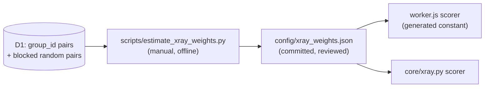

# 0002 — Learn X-Ray duplicate-match weights from photo-hash pairs

## Status
Proposed

## Why

Since the fix in [`production-fixes.md` §5.5](../production-fixes.md), `workerCandidateMatchesTarget` in `cloudflare/worker.js` (twin: `_candidate_matches_target` in `core/xray.py`) is a fixed rule. Any known conflict in layout or building height rejects a candidate, and floor plus area need one more agreeing field. The rule is deterministic and safe, but blunt in two ways. Every agreeing field counts the same, so a common "floor 1" weighs as much as a rare 25-storey height. And two of its constants are assumptions: a ±1 floor slack, and rooms = bedrooms + 1 or + 2 (measured on only 23 golden posts).

The constraints are fixed. X-Ray must stay deterministic and free: no LLM, and no hand-picked weights or thresholds.

The standard method for this is Fellegi-Sunter record linkage (Fellegi & Sunter, JASA 1969), as used by Splink. Each field has two numbers. `m` is how often it agrees when two listings are the same flat, and `u` is how often it agrees by chance. An agreeing field adds `log2(m/u)`, a conflicting one adds `log2((1-m)/(1-u))`, which is negative, and an unknown one adds 0. The sum is compared with two thresholds: match, possible match, or no match.

The labels already exist. Listings that share a photo-hash `group_id` (`core/dedup.py`) are known duplicates.

## What

- **Comparison levels** extend today's agree/conflict/unknown helpers:
  - area: within 0.5 m² or within 1.5 m²
  - floor: equal
  - total floors: equal, or a difference of 1
  - layout: rooms equal, or rooms and bedrooms compatible
  - location: child district named in the candidate's subdistrict or street

  An unknown field always weighs 0.
- **`m`** is counted on `group_id` pairs. **`u`** is counted on random pairs drawn inside the same blocking as `queryWorkerExactDuplicates`: district aliases, area ±1.5, same deal type. Blocking changes base rates, so `u` must not come from unblocked pairs.
- **Thresholds** come from held-out `group_id` pairs. The upper threshold is the lowest score with precision ≥ 95%. Scores between the lower and upper thresholds render as a "possible duplicate" line; the user chooses the Georgian wording.
- **Delivery.** The script writes `config/xray_weights.json`, including the pair counts behind every weight. It also regenerates a marked constant block in `worker.js`, and a test asserts the two are equal. No KV read is added per X-Ray.
- **Fallback.** With fewer than 200 labeled pairs, or a missing file, the §5.5 rule stays in force.

## Consequences

- **Gains:** rare facts count more than common ones; the two assumed constants become measured; "possible duplicate" becomes a defined tier; every weight can be traced to counts.
- **Costs:**
  - Estimation reads D1 rows, so it runs by hand, never in the cron. It uses only indexed and chunked queries (ADR 0001).
  - Weights go stale as the market changes, so the script should be re-run periodically.
  - It adds one script, one JSON file, and a parity test.
- **Known bias:** `group_id` pairs share photos, so they are mostly portal-to-portal re-posts. `m` may be optimistic for text-only Facebook posts. Report precision and recall separately for Facebook-style inputs.
- **Field correlation:** Fellegi-Sunter treats fields as independent, but area and rooms are correlated and may be counted twice. Check this on held-out pairs before accepting the thresholds.
- **Subscriber safety:** only the X-Ray reply changes; scraping, filtering and alerts do not. The incident and golden tests in `tests/js/` and `tests/test_xray.py` still gate the Worker deploy. A D1 or Worker outage affects only re-estimation, not the live X-Ray.

## Tasks

- [ ] Confirm `idx_properties_group_id` exists on D1, then count `group_id` pairs with one indexed query.
- [ ] `scripts/estimate_xray_weights.py`: fetch pairs through the existing D1 client in chunks of 50, compute `m`/`u` per level, and write the JSON with counts. Add a unit test on a synthetic SQLite fixture.
- [ ] Scorer in `worker.js` and `core/xray.py`, with the generated constant and a parity test.
- [ ] Pick thresholds on held-out pairs, report precision and recall, and keep the incident and golden tests green.
- [ ] The user approves the "possible duplicate" wording, then accepts this ADR.
