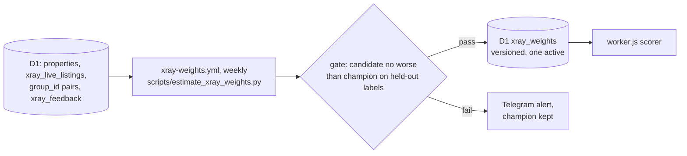

# 0002 — Learn X-Ray duplicate-match weights automatically

## Status
Accepted

## Why

Since the fix in [`production-fixes.md` §5.5](../production-fixes.md), `workerCandidateMatchesTarget` in `cloudflare/worker.js` (twin: `_candidate_matches_target` in `core/xray.py`) is a fixed rule. It is deterministic and safe but blunt. Every agreeing field counts the same, so a common "floor 1" weighs as much as a rare 25-storey height. Two of its constants are assumptions: a ±1 floor slack, and rooms = bedrooms + 1 or + 2 (measured on 23 golden posts).

The constraints are these:
- every reply is deterministic;
- running cost is zero;
- there is no LLM;
- there are no hand-picked weights or thresholds;
- there is no step a person must run periodically.

The first draft of this ADR needed a hand-run estimation script, re-run as the market moves. It was rejected for that on 2026-11-08.

Standard practice is Fellegi-Sunter record linkage, as in [Splink](https://moj-analytical-services.github.io/splink/topic_guides/training/training_rationale.html). `u` (chance agreement) is counted on random pairs and needs no labels. `m` (agreement on true matches) is fitted by expectation maximisation and needs no labels either. This is the split Splink recommends. Where labels exist, rules in code supply them, not hand labelling ([weak supervision](https://arxiv.org/abs/2106.10821)). A new model replaces the old one only after an automatic comparison (champion/challenger).

## What

- **Comparison levels.** They extend today's agree/conflict/unknown helpers to area, floor, total floors, layout, and location (including the micro-district). A level boundary only groups values. The weight of each level is learned, so a level that carries no signal ends up near zero. An unknown field weighs 0.
- **Estimation.** A weekly GitHub Actions cron (free) computes three numbers:
  - `u`, from random pairs drawn inside the blocking of `queryWorkerExactDuplicates`;
  - `m`, by EM over blocked pairs, seeded from labelled pairs;
  - λ (the match prevalence), counted directly on labelled pairs.

  It reads D1 through the existing `/api/db/query` route, using indexed queries chunked at 50 ([ADR 0001](0001-eliminate-d1-full-table-scans.md)).
- **Labels.**
  - Pairs that share a photo-hash `group_id` (`core/dedup.py`) are weak matches. They only give EM its starting values and are never an exam answer. The pairs of one group together weigh 1 (each weighs `2 / (s·(s − 1))` in a group of s), so a 60-member render group counts as much as a 2-member one. They never inform the area field, because dedup only groups areas within ±15%.
  - The admin's buttons under every X-Ray candidate (duplicate lines, owner search, photo search, the weekly review) write to D1 `xray_feedback`: ✅ = 1, ❌ = 0, 🤷 = -1 (can't tell: kept, never scored). Only the admin's answers count, and a later press replaces an earlier one. The rules for pressing are in the [labeling guide](../xray-labeling-guide.md).
  - Each saved reply keeps the shown candidates' fields (`xrayResultCandidate` in `worker.js`, `snapshot_fields` in `core/xray.py`), so an answer is judged on what the admin saw. Answers given before 2026-11-09 are filled from `properties` and marked `backfilled`.
  - `core/golden_pairs.py` turns the answers into the **golden pairs**: one record per answer, with no phone number, author id or chat id (the repository is public), only whether the two sides share them.
  - Human answers are the exam, never the textbook: no weight is fitted on them. Organic answers cover only pairs the bot chose to show, which the old rule had already accepted. The weekly review adds pairs the bot did not choose.
- **Gate.**
  - Labels are split into a fit set and a held-out set by a hash of the pair id, so the split is deterministic.
  - A candidate is promoted only if its precision and its recall on held-out pairs are both no worse than the champion's. Both are compared by a one-sided 95% Wilson bound, which is a statistical convention rather than a tuned value. A small label set therefore cannot promote a model by chance.
  - Facebook-style pairs (no photo) are scored separately and must also be no worse.
  - The incident regression tests must pass with the candidate.
  - The first champion is the §5.5 rule. Until a candidate passes, the scorer runs in shadow mode: replies use the rule, and disagreements are logged.
- **Thresholds.**
  - A pair is a "possible duplicate" when its posterior match probability is above one half. The reply line reads `🤔 შესაძლოა იგივე ბინაა`.
  - A pair is a "match" from the lowest score whose held-out precision is no lower than the champion's.
  - Neither threshold is typed in by hand.
- **Delivery.**
  - Each run writes a row to D1 `xray_weights` holding the version, the weights, the thresholds, and the pair counts behind every weight. At most one row is active.
  - The Worker reads the active row once per isolate. If the row is missing or invalid, the §5.5 rule stays in force.
  - Each X-Ray reply logs the version it used.
- **Rollback.** If the share of ❌ answers under the new version rises above the previous version's (by the same bound), the next run reactivates the previous row and sends an alert.

## Consequences

- **Gains:**
  - rare facts count more;
  - the assumed constants become measured;
  - nothing has to be run by hand;
  - accuracy on Facebook posts is measured from real answers;
  - every weight traces back to counts;
  - every reply can be reproduced from its version.
- **Costs:**
  - one weekly D1 read, one D1 read per Worker isolate, and two new tables;
  - EM can converge to a biased fit when the blocked sample is biased, as Splink warns. The gate keeps such a fit out of production;
  - fields are treated as independent, yet area and rooms are correlated. This is measured on held-out pairs, and the gate decides.
- **Subscriber safety:** only X-Ray replies change; scraping, filtering and alerts do not. If D1 is down, the §5.5 rule is used. The incident tests and the golden tests in `tests/js/` and `tests/test_xray.py` still gate the Worker deploy.
- **Dependency:** the ✅/❌ buttons arrive with ADR 0003 stage 2. Until then the system learns only from photo pairs and EM.

## Tasks

- [ ] Add the D1 tables `xray_feedback` and `xray_weights` in `core/database.py`.
- [ ] Write `scripts/estimate_xray_weights.py`: `u`, EM `m`, λ, the hashed split, and JSON output with counts. Add a unit test on a synthetic SQLite fixture.
- [ ] Add `.github/workflows/xray-weights.yml`: weekly estimation, gate, publish, rollback, and a Telegram alert.
- [ ] Add the scorer to `worker.js` and `core/xray.py`, with the §5.5 rule as fallback and a parity test.
- [x] The user approves the Georgian wording for "possible duplicate" (`🤔 შესაძლოა იგივე ბინაა`, 2026-11-08) and accepts this ADR.
