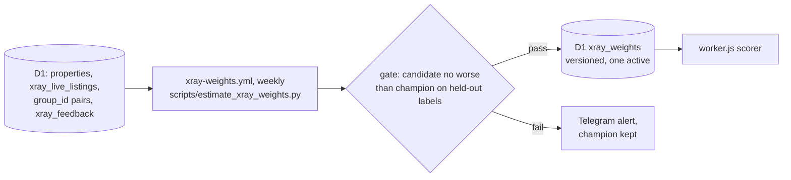

# 0002 — Learn X-Ray duplicate-match weights automatically

## Status
Accepted

## Why

Since the fix in [`production-fixes.md` §5.5](../production-fixes.md), `workerCandidateMatchesTarget` in `cloudflare/worker.js` (twin: `_candidate_matches_target` in `core/xray.py`) is a fixed rule. It is deterministic and safe but blunt. Every agreeing field counts the same, so a common "floor 1" weighs as much as a rare 25-storey height. Two of its constants are assumptions: a ±1 floor slack, and rooms = bedrooms + 1 or + 2 (measured on 23 golden posts).

The constraints are these:
- every reply is deterministic;
- running cost is zero;
- there is no LLM;
- there are no hand-picked weights or thresholds;
- there is no step a person must run periodically.

The first draft of this ADR needed a hand-run estimation script, re-run as the market moves. It was rejected for that on 2026-11-08.

Standard practice is Fellegi-Sunter record linkage, as in [Splink](https://moj-analytical-services.github.io/splink/topic_guides/training/training_rationale.html). `u` (chance agreement) is counted on random pairs and needs no labels. `m` (agreement on true matches) is fitted by expectation maximisation and needs no labels either. This is the split Splink recommends. Where labels exist, rules in code supply them, not hand labelling ([weak supervision](https://arxiv.org/abs/2106.10821)). A new model replaces the old one only after an automatic comparison (champion/challenger).

## What

- **Comparison levels.** They extend today's agree/conflict/unknown helpers to area, floor, total floors, layout, and location (including the micro-district). A level boundary only groups values. The weight of each level is learned, so a level that carries no signal ends up near zero. An unknown field weighs 0.
- **Estimation.** A weekly GitHub Actions cron (free), `scripts/estimate_xray_weights.py`, reads the comparison columns of `properties` once, in pages on the primary key ([ADR 0001](0001-eliminate-d1-full-table-scans.md)), and enumerates every pair in a block (same district and deal type: 7.3 million pairs in November 2026, a few minutes):
  - `u` is each level's share over all those pairs, counted exactly, with no sample.
  - `m` comes from EM in four sessions, one per strong field (floor, area, rooms, building height). Each session runs over the pairs where the other three agree, so most of its pairs are the same flat and EM learns the field from them, not from look-alike flats. Location is averaged over the four. Photo-group pairs give the starting values.
  - λ: each session's match count, divided by the share of true matches its block keeps, gives the number of same-flat pairs; λ is their mean over all block pairs.
  - A +1 (Laplace) count on every level keeps a level that is never seen from getting an infinite weight.
- **Labels.**
  - Pairs that share a photo-hash `group_id` (`core/dedup.py`) are weak matches. They only give EM its starting values and are never an exam answer. The pairs of one group together weigh 1 (each weighs `2 / (s·(s − 1))` in a group of s), so a 60-member render group counts as much as a 2-member one. They never inform the area field, because dedup only groups areas within ±15%.
  - The admin's buttons under every X-Ray candidate (duplicate lines, owner search, photo search, the weekly review) write to D1 `xray_feedback`: ✅ = 1, ❌ = 0, 🤷 = -1 (can't tell: kept, never scored). Only the admin's answers count, and a later press replaces an earlier one. The rules for pressing are in the [labeling guide](../xray-labeling-guide.md).
  - Each saved reply keeps the shown candidates' fields (`xrayResultCandidate` in `worker.js`, `snapshot_fields` in `core/xray.py`), so an answer is judged on what the admin saw. Answers given before 2026-11-09 are filled from `properties` and marked `backfilled`.
  - `core/golden_pairs.py` turns the answers into the **golden pairs**: one record per answer, with no phone number, author id or chat id (the repository is public), only whether the two sides share them.
  - Human answers are the exam, never the textbook: no weight is fitted on them. Organic answers cover only pairs the bot chose to show, which the old rule had already accepted. The weekly review adds pairs the bot did not choose.
- **Weekly review.** After estimation the same job sends the admin up to ten close-area pairs from the whole database, with the usual ✅/❌/🤷 buttons and without saying why each was picked: five where the champion and the challenger disagree (one pair per kind of disagreement, the kinds that cover the most pairs first, so each answer settles a different question), and five drawn at random with a probability that leans toward likely matches (half in proportion to the posterior, half uniform). Each random pick keeps its probability, so counts over those answers can be re-weighted into unbiased estimates (importance sampling, as in OASIS). A pair already answered or already sent is never sent again. Each pair arrives as one picture of both listings' saved photos (top row ა, bottom row ბ) with the buttons under it, because agents delete and re-post listings and the saved photos outlive the page. MyHome photos saved before its October 2026 host move are read from the new host. A manual run can send a larger batch at once (a labeling sprint, e.g. 30 disagreeing and 10 random pairs; the disagreeing ones round-robin over the kinds) or none, to get a fresh verdict right after the answers. A pair whose two listings share a photo group is never sent (the photos already say same flat), and a listing already shown is not sent again.
- **Gate.**
  - The exam is every golden pair with a ✅ or ❌ answer whose fields are known. No answer is used for fitting, so there is no fit/held-out split.
  - The champion is the §5.5 rule. The challenger says "same flat" when its posterior is above one half.
  - The test counts independent flats, not pairs: listing pairs that share a listing or a photo group form one unit, and a post's candidates form one unit (its reply). A unit wins when the challenger is right on more of its disagreeing pairs. The test is a one-sided exact sign test at 5%, a statistical convention rather than a tuned value. Precision and recall are not compared, because on organic answers the champion's recall is 100% by construction: it chose every pair that was shown.
  - On 2026-11-10 the admin's answers settled two incident rules: the micro-district vector left the gate (6 of 6 micro-district-conflict pairs were the same flat; the micro-district read from street text is unreliable), and "floor and area alone are not enough" became part of the challenger (one answer agreed).
  - The challenger must make no more false matches (❌ pairs it calls the same) than the champion.
  - Facebook-style targets are checked on their own: there the challenger must win at least as many disagreements as it loses, again with no more false matches.
  - It must answer "no" on the rule vectors marked `"gate": true` in `tests/fixtures/xray_rule_vectors.json`, the false-duplicate incidents.
  - dedup groups photos without looking at the floor, so the photo groups are independent evidence for it: EM's floor-equal m must sit inside their 95% Wilson interval, or the week does not count. A loose pool once taught EM "look-alike flats" (λ = 0.156, floor-equal m = 0.17 against the photos' 0.98); this check stops that.
  - Until a challenger passes, nothing changes for users. The weekly summary shows the disagreements: this is the shadow mode.
- **Thresholds.** A pair is a "possible duplicate" when its posterior is above one half (`🤔 შესაძლოა იგივე ბინაა`). A stricter "match" tier, if any, is set from the exam in the change that turns the scorer on. No threshold is typed in by hand.
- **Delivery.**
  - Each run writes one row to D1 `xray_weights` with:
    - its version (`w-<ISO week>`);
    - the weights, the thresholds, the pair counts behind every weight;
    - the hash of the golden pairs it was tested on;
    - the gate report;
    - a status of `candidate` or `passed`.
  - The run's files (golden pairs, weights, report; no phone numbers) are kept as a 90-day Actions artifact.
  - A later change makes the Worker read the newest `passed` row once per isolate, with the §5.5 rule as the fallback, and log the version each reply used.

## Consequences

- **Gains:**
  - rare facts count more;
  - the assumed constants become measured;
  - nothing has to be run by hand;
  - accuracy on Facebook posts is measured from real answers;
  - every weight traces back to counts;
  - every reply can be reproduced from its version.
- **Costs:**
  - one weekly D1 read, one D1 read per Worker isolate, and two new tables;
  - EM can converge to a biased fit when the blocked sample is biased, as Splink warns. The gate keeps such a fit out of production;
  - fields are treated as independent, yet area and rooms are correlated. This is measured on held-out pairs, and the gate decides.
- **Subscriber safety:** only X-Ray replies change; scraping, filtering and alerts do not. If D1 is down, the §5.5 rule is used. The incident tests and the golden tests in `tests/js/` and `tests/test_xray.py` still gate the Worker deploy.
- **Dependency:** the ✅/❌ buttons arrive with ADR 0003 stage 2. Until then the system learns only from photo pairs and EM.

## Tasks

- [x] The user approves the Georgian wording for "possible duplicate" (`🤔 შესაძლოა იგივე ბინაა`, 2026-11-08) and accepts this ADR.
- [x] Keep the shown candidates' fields, add 🤷, build the golden pairs (`core/golden_pairs.py`).
- [x] Add the D1 table `xray_weights`, `core/xray_weights.py`, `scripts/estimate_xray_weights.py` and `.github/workflows/xray-weights.yml` (estimation, gate, summary).
- [x] The weekly review: pairs the bot did not choose, sent to the admin.
- [ ] Turn the scorer on in `worker.js` and `core/xray.py` after the first `passed` row, with the §5.5 rule as the fallback, a parity test, and a rollback when the share of ❌ answers rises.
