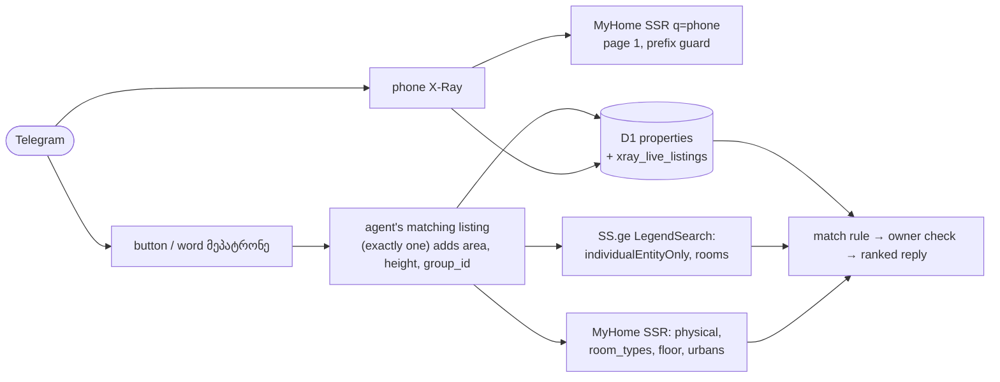

# 0003 — X-Ray searches MyHome and SS.ge live for phone and owner lookups

## Status
Accepted

## Why

The phone branch of `handleXRayQuery` in `cloudflare/worker.js` (twin: `run_xray_on_db` in `core/xray.py`) reads only D1 `properties`. D1 holds what the scraper fetched for subscriber envelopes (`config/filters.json`: 40–65 m², six districts). So most of an agent's or owner's listings are missing, and the broker verdict sees only part of the account. A post without an area falls into that branch too, because `hasFbSignal` in `parseXRayInput` needs `area_m2`. The district, rooms and floor parsed from it are then dropped. Example: a Gldani 6th micro-district, 3-room, floor-1 post with only a phone number.

The user wants X-Ray to find the real owner of the same flat behind an agent post, across MyHome, SS.ge and D1. The constraints from [ADR 0002](0002-xray-duplicate-match-weights.md) still hold. The lookup must be deterministic and free to run, with no LLM and no hand-picked weights or thresholds. A wrong owner is worse than "not found".

A live probe on 2026-11-07 showed the following.

- **MyHome JSON API.** `api-statements.tnet.ge/v1/statements` answers 401 to anonymous calls.
- **MyHome search page.** The SSR page (`/ka/s/udzravi-qoneba/`, `__NEXT_DATA__` → `statements/list`) honours these parameters:
  - `q=<9 digits>`: exact account phone. Wrong last digits return 0. The spaced and `995` forms return 0.
  - `users=<user_id>`
  - `room_types`, `floor_from`/`floor_to`, `owner_type=physical`, `urbans`

  An unknown parameter is ignored without an error, and the page returns 24 unfiltered listings. Micro-districts appear only in the address text, for example `გლდანი - VI მ/რ`.
- **SS.ge.** `POST /v1/RealEstate/LegendSearch` honours `rooms` and `advancedSearch.individualEntityOnly`. It has no floor or user filter.
- **Full phone number.** Revealing it on MyHome needs reCAPTCHA. It is not used.

## What

- **Parser.** A phone-kind result keeps the text attributes. A new `micro` field reads both Arabic and Roman numerals ("მე-6 მიკრო", "VI მ/რ"). `compareLocation` compares it as agree, conflict or unknown.
- **Phone lookup.**
  - Live MyHome hits are merged with D1 rows and deduplicated by id.
  - The reply shows the verdict, "N+" when page 1 is full, the last 5 listings, and a link to the `q=` page.
  - **Guard.** The first live hit's masked `user_phone_number` must start with the queried number's first six digits. Otherwise every live hit is dropped.
- **Owner search.**
  - **Trigger.** A button with `callback_data` of `own:<compact target>` (64 bytes or less) or the word "მეპატრონე". The word reads `last_xray` from the user's KV profile. `handleCallbackQuery` receives `env`.
  - **Candidates.** They come from three sources: the MyHome SSR search, SS.ge `LegendSearch` (floor filtered locally on `floorNumber`), and D1 exact duplicates plus `group_id`. They are filtered by `workerCandidateMatchesTarget` and `micro`. The agent's own listings (same prefix or `author_id`) are dropped.
  - **Owner check.**
    - MyHome: a physical account counts as the owner only if all of its `users=` listings cluster into one flat (the clustering in `evaluateWorkerBrokerVerdict`).
    - SS.ge: `fetchLiveStatementDetails` decides.
  - **Ranking.** A photo match on `group_id` comes first, then the number of agreeing fields. Price is shown only as a difference, never as a veto.
- **Sources.** Each source has its own timeout and try/catch. A failed source is named in the reply, and D1 alone is the fallback. Search URLs are cached briefly in `caches.default`. Subrequests stay under the free-plan cap of 50.
- **Storage.** Live hits go to a new D1 table, `xray_live_listings`, created in `core/database.py`. They never go to `properties`. `classify_scraped_listings` and `is_seen` read `properties`, so a Worker insert there would suppress subscriber alerts.
- **Canary.** `.github/workflows/xray-canary.yml` runs daily. It runs `worker.js` against the live sites with a phone chosen at run time, never one written in the code, and alerts the admin chat on Telegram. It does not gate deploys.
- **Out of scope.** Watch mode, which notifies the user when an owner posts later, gets its own ADR.

## Consequences

- **Gains:**
  - A phone lookup sees the whole active account.
  - Owner search covers flats outside the subscriber filters.
  - A site change is reported the same day.
- **Costs:**
  - The design relies on undocumented SSR parameters that can change without notice. The guard and the canary make that failure loud.
  - It adds Worker code, one table, and up to about 15 subrequests per owner search.
  - Worker CPU must be measured on the free plan. If parsing goes over the limit, `__NEXT_DATA__` is extracted with `HTMLRewriter`.
- **Limits:**
  - A post with no area and no matching agent listing yields candidates, not a verdict.
  - Photo matches exist only for listings the scraper has hashed.
  - An owner who never posted cannot be found.
- **Subscriber safety:**
  - Scraping, filtering and alerts do not change, and the Worker never writes to `properties`.
  - The incident tests and the golden-set ratchet still gate the deploy.
  - If MyHome or SS.ge is down, X-Ray answers from D1 only. If D1 is down, the existing error message is shown.
- **Twin.** `core/xray.py` mirrors the parser, the merge, the guard and the owner rule, and the golden baselines stay equal.

## Tasks

- [ ] Stage 1 on `feat/xray-live-phone`:
  - parser and `micro`
  - SSR helpers (`extractNextData`, `fetchMyHomeSearch`, `parseMyHomeListItem`)
  - guarded `q=` lookup, merge, "N+", link and fallback
  - cache and `xray_live_listings`
  - twin, offline tests and canary
- [ ] Stage 2 on `feat/xray-owner-search`:
  - button and word
  - target enrichment
  - search across the three sources
  - owner check and ranking
  - subrequest budget
  - twin, tests and canary checks
- [ ] Measure CPU and subrequests with `wrangler dev` on the example post.
- [ ] The user accepts this ADR.

Partly superseded by ADR 0004: MyHome is read live by a GitHub Actions job, not by the Worker.
