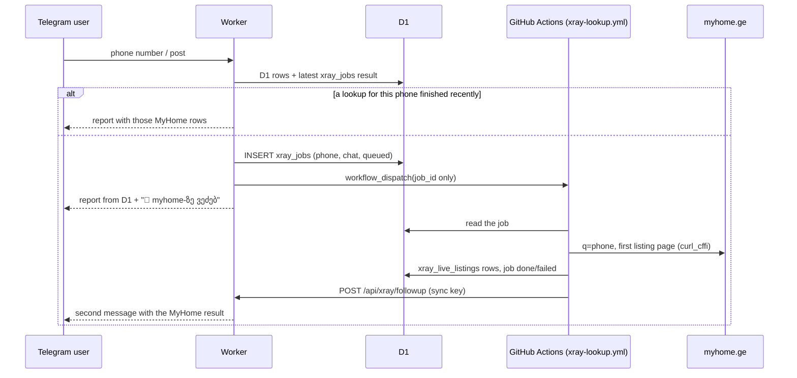

# 0004 — MyHome live reads run on GitHub Actions, not in the Worker

## Status
Accepted (2026-11-08). Supersedes the "where MyHome is fetched" part of [ADR 0003](0003-xray-live-phone-and-owner-search.md).

## Why

ADR 0003 had `cloudflare/worker.js` read the MyHome search page live. A live run of the canary on 2026-11-08 showed that this cannot work:
- From the Worker (tested through its `/?url=` proxy), myhome.ge answers with a 403 Cloudflare challenge page, both for `/ka/s/...` and for `/ka/pr/<id>/`.
- The JSON API answers 401 to anonymous calls.
- A plain Node or Worker `fetch` never gets past the challenge.

The only client that reads MyHome is curl_cffi with `impersonate="chrome124"`, from a home IP or from a GitHub Actions runner. The scraper already depends on this: `scrapers/base.py` tries the proxy, gets 403, and falls back to a direct curl_cffi request (scrape.yml logs: API 401, then 72 sale and 46 rent listings fetched). The same cause means the Worker's existing MyHome enrichment in `fetchLiveStatementDetails` already fails silently in production.

SS.ge is unaffected: the token from `refresh_access_token` and `LegendSearch` both work from the Worker.

## What

- **Fetching.** `scripts/xray_lookup.py` does the MyHome reads with `MyHomeScraper.fetch_html` and the parsing and guard helpers in `core/xray.py` (`find_statements_list`, `parse_myhome_list_item`, `live_phone_result`). Those helpers become production code. The Worker no longer fetches MyHome for this lookup.
- **Privacy.** The repository is public, and so are workflow inputs and logs. The workflow therefore receives only an opaque job id, and the phone number and chat id stay in D1 `xray_jobs`. The script prints counts only.
- **Reuse.** A lookup that finished within the last 30 minutes is shown again without starting a new job.
- **No concurrency group.** GitHub keeps one pending run per group and cancels the rest, which would drop a user's follow-up.
- **Canary.** The daily canary moves to Python (`scripts/xray_canary.py`), so it exercises the same client as the job.

## Consequences

- **Gains:** MyHome results come from a path that already works every 15 minutes in production. The Worker stays thin, and running cost stays zero.
- **Costs:**
  - The MyHome part of the answer arrives as a second message, about a minute later, because of runner start-up.
  - Dispatch needs a `GITHUB_PAT` secret on the Worker. This ADR assumed the Worker already had one; on 2026-11-08 it had none, so no job was ever queued (setup: `cloudflare/README.md`). The workflow must be on `master` before the Worker can dispatch it.
  - There is one more table (`xray_jobs`) and two more workflows.
- **Failure:**
  - Without a token, or if the dispatch fails, the reply says MyHome could not be checked and shows D1 and the last saved rows.
  - If the job fails, the follow-up says so.
  - If MyHome starts blocking GitHub runners, the canary reports it.
- **Subscriber safety:** scraping and alerts do not change. Live rows still never go into `properties` (ADR 0003).
- **Stage 2.** Owner search uses the same job for MyHome, and the Worker for SS.ge.
