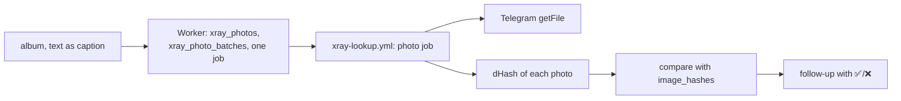

# 0005 — X-Ray compares a post's photos with the database

## Status

Accepted

## Why

The X-Ray judges a post by its text. Measured on 2026-11-08:

- The bot dropped every photo: a message was handled only if it had `text` or `caption`.
- Of the 100 golden Facebook posts, 70 have photos, 33 name no district, 29 no area and 49 no floor.
- Text cannot tell flats apart in a new building. At 4000 Meskhi St. 13, dozens of 58 m² third-floor flats were for sale, and a post said floor 3/15 where MyHome says 3/18.
- D1 already holds 9,940 dHashes for 3,380 listings (`image_hashes`), and [`core/dedup.py`](../../core/dedup.py) already matches listings by photo.

The constraints of [ADR 0002](0002-xray-duplicate-match-weights.md) hold: deterministic, free to run, no LLM, no hand-picked threshold.

## What

- **Intake.** `handleTelegramWebhook` accepts a message that has `photo`. Telegram sends an album as one message per photo with a shared `media_group_id`; the caption is on one of them. The Worker stores each photo's `file_id` (largest size) in `xray_photos` under a batch id, `<chat>:<media_group_id>` or `<chat>:m<message_id>`. `INSERT OR IGNORE INTO xray_photo_batches` decides which update queues the job: only the one that created the batch (`meta.changes = 1`). A captioned photo also runs the normal X-Ray of its text.
- **Job.** A `photo` job waits until the newest photo of the batch is 10 seconds old (an album's messages arrive within a few seconds), downloads each photo from Telegram, hashes it with `core/dedup.py`'s dHash, and stores the hash in `xray_photos.dhash`.
- **Match.** The job reads every row of `image_hashes` and counts, per listing, the photo pairs within `HASH_THRESHOLD` (10, the duplicate finder's own limit). A listing is shown when `is_photo_duplicate` holds, the duplicate finder's own rule: two photos, or one photo that the caption's price (within 25%) and area (within 10%) confirm. Both now live in `core/dedup.py` as functions that `DuplicateDetector` calls, so there is one rule.
- **Logos and renders.** A post photo that is found in the listings of two different districts is dropped and the reply says so. A flat is in one district, so this needs no number.
- **Reply.** `core/photo_match.py` builds the text and the candidate list, `scripts/xray_lookup.py` stores them in `xray_jobs.result`, and the existing follow-up sends them with the existing `fb:` ✅/❌ buttons, which write `xray_feedback` for [ADR 0002](0002-xray-duplicate-match-weights.md).
- **Secrets.** The job needs `TELEGRAM_BOT_TOKEN` (already a repository secret) to download files. The repository is public, so nothing prints the token, a photo link, the chat id or the batch id (it contains the chat id).

## Consequences

- Only listings with stored hashes are searchable: 3,380 of 18,412 on 2026-11-08. The reply states how many listings it compared.
- About 10,000 D1 row reads per photo request (`load_listing_hashes` pages through `image_hashes` by primary key). It must never run in a loop. If requests become frequent, hash lookup should move into a table indexed by hash prefix.
- An answer takes about a minute (job start, the album wait, the download).
- Telegram recompresses a photo (JPEG, longer side at most 1280). Measured on 2026-11-08 with 36 real listing photos: the dHash of the original equals the stored one (0 bits apart), and a Telegram-like recompression (JPEG quality 70 and 85, and a half-size copy) moves it by at most 3 bits of 64, against the limit of 10.
- A cropped, mirrored or watermarked photo may not match.
- The lookup job and the canary now need Pillow (`xray-lookup.yml`, `xray-canary.yml`): the job imports `core/dedup.py`, and the canary imports the job.
- The tables `xray_photos` and `xray_photo_batches` are created by the next scraper run (`init_db`); until then a photo gets "could not start".

## Photos in the owner search

Decided on 2026-11-08:

- A candidate with 2 or more matching photos counts as the same flat even if a text field conflicts (e.g. building height 15 vs 18 floors). It is shown under ✅ **ფოტოები ემთხვევა:**, with the conflicting fields named (`⚠ ტექსტში განსხვავდება: <fields>`).
- With 1 matching photo, text conflicts still reject the candidate.
- Photo matches must still pass `_verified_owner` (the broker check): an account selling two or more flats is never shown as an owner, even with matching photos.
- At most `MAX_PHOTO_CANDIDATES = 24` candidates are hashed, and at most 3 photos per candidate are downloaded.
