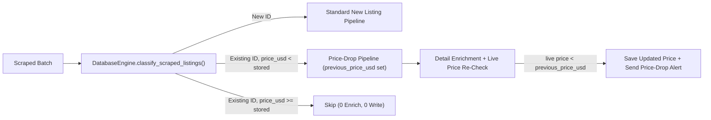

# In-Place Price Drop Sniper — Design Spec

## Intent & Why

Currently, [`main.py`](../../../main.py) filters scraped listings via `DatabaseEngine.filter_new_listings(all_unique_ids)`, which permanently skips any listing ID already present in the `properties` table. When an owner lowers the price on an existing MyHome.ge or SS.ge listing (for example, dropping from `$75,000` to `$68,000` on the same URL), the system ignores it completely — even if the new price brings the apartment into a subscriber's budget or creates a new bargain.

This feature detects in-place price drops on existing listings with **0 additional Cloudflare D1 row reads and 0 additional HTTP requests** by piggybacking on the existing primary-key batch lookup.

## Goals, Non-Goals & Anti-Goals

- **Goals:**
  - Piggyback on the existing batch `SELECT` in [`core/database.py`](../../../core/database.py) (`SELECT id, price_usd FROM properties WHERE id IN (...)` in chunks of 50) to detect when `scraped.price_usd < stored.price_usd`.
  - Re-evaluate price-dropped listings through hygiene filters, subscriber filter matching, statement detail enrichment, and duplicate detection.
  - Re-verify after statement detail enrichment that the live authoritative `price_usd` is still strictly below `previous_price_usd` before alerting.
  - Notify matching subscribers (including subscribers who were previously notified at the old higher price, as well as subscribers whose budget the listing newly entered).
  - Render a clear price-drop banner in [`notifier/telegram_bot.py`](../../../notifier/telegram_bot.py) showing the previous price and exact dollar reduction (down to `$1`).
- **Non-Goals:**
  - Multi-step historical price chart tables or extra database tables.
  - Alerting on price increases (`scraped.price_usd > stored.price_usd`).
- **Anti-Goals:**
  - Never add extra D1 `SELECT` queries, full-table scans, or per-listing DB lookups.
  - Never re-alert on the next cycle once the lower price has been persisted to `properties`.

## Constraints

- Cloudflare D1 bound parameter limit: maximum 50 IDs per `IN (...)` query chunk (`CHUNK_SIZE = 50`).
- Zero extra D1 row reads during steady-state cycles when prices have not dropped.
- Backward compatibility: `DatabaseEngine.filter_new_listings(listing_ids)` must retain its existing signature and behavior for all existing callers and tests.

## Approaches Considered

1. **Piggyback on `properties` batch PK lookup (`SELECT id, price_usd`) + in-memory `_seen_prices` cache (Selected):**
   - Zero extra D1 row reads (D1 bills per row scanned, not per column read).
   - Zero schema migrations required (`price_usd` is already stored on `properties` and updated via `ON CONFLICT(id) DO UPDATE`).
2. **Separate `price_history` table in D1:**
   - Rejected: doubles D1 write operations and requires extra joins/reads per cycle.
3. **Periodic background re-scraper for old URLs:**
   - Rejected: wastes Cloudflare Worker proxy requests and portal rate limits.

## Architecture & Data Flow

